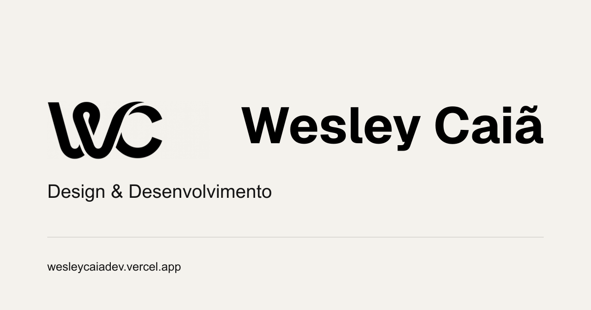

# TASK 18 — Validação pós-publicação e acabamento

Data: **19/10/2026**. Inspeção do deployment público, configuração autenticada da Vercel, GitHub e código local.

**Resultado da auditoria inicial:** a V2 correta está publicada e funcional. SEO técnico de produção está habilitado. Duas correções localizadas foram preparadas e validadas antes da autorização. Não houve deploy, push ou alteração de configuração durante essa auditoria. Wesley autorizou posteriormente a publicação delimitada na seção 7.

## 1. Commit, deployment e domínio

| Item | Resultado verificado |
| --- | --- |
| Repositório | `wesleycaiadev/meu-portifolio` |
| Branch principal | `main` |
| Commit de `main` e do deployment Production | `2222eed8fd445ea626b1827d7085bed8fc1ba1c0` |
| Projeto Vercel | `wesleycaiadevs-projects/my-portifolio` |
| Deployment atual | `4c8ZnLQEqnTpy33BHhdZuCHgAcv1` — Ready, Production, Current |
| URL oficial | <https://wesleycaiadev.vercel.app/> — Valid Configuration, Production |
| URL imutável do deployment | <https://my-portifolio-fadig1gev-wesleycaiadevs-projects.vercel.app/> |
| Alias de branch exibido | `my-portifolio-git-main-wesleycaiadevs-projects.vercel.app` |

O SHA coincide na API do GitHub, no registro do deployment e na interface da Vercel. A home pública contém a identidade WC, navegação Projetos/Sobre/Contato e os dois cases. Os nomes Fokus, Vistoriador OpenCell e VgTech não aparecem no HTML recuperado. O navegador aberto também confirmou um canvas WC e cinco pins. A hipótese de V1 no domínio oficial **não se reproduziu**; conteúdo antigo em serviço de consulta não foi usado como evidência do deploy atual.

Evidências: [GitHub/deployment](previews/task18/github.json), [Vercel Production](previews/task18/vercel-production.txt), [domínio](previews/task18/vercel-domains.txt), [navegador atual](previews/task18/current-browser.json) e [home](previews/task18/live-home.png).

## 2. SEO técnico — estado público

`SITE_URL` foi revelada e conferida na interface da Vercel: **`https://wesleycaiadev.vercel.app`**, somente em **Production**. A lista exibia uma variável de projeto e nenhuma compartilhada. Nenhuma variável foi modificada. A saída já compilada de produção confirma a origem esperada.

| Rota | HTTP | Canonical | Robots | Compartilhamento atual |
| --- | --- | --- | --- | --- |
| `/` | 200 | `https://wesleycaiadev.vercel.app` | `index, follow` | OG textual; Twitter `summary`; **imagem ausente** |
| `/projetos/spasmooth` | 200 | URL oficial da própria rota | `index, follow` | OG com screenshot real; Twitter `summary_large_image` |
| `/projetos/mf-consultoria` | 200 | URL oficial da própria rota | `index, follow` | OG com screenshot real; Twitter `summary_large_image` |
| `/robots.txt` | 200 | Não se aplica | `Allow: /`, `Disallow: /playground` | Anuncia o sitemap oficial |
| `/sitemap.xml` | 200 | Não se aplica | Não se aplica | Somente home e os dois cases |
| Três rotas `/playground*` | 404 | Não são páginas públicas | `noindex` | Indisponíveis em produção |

As três páginas têm títulos e descrições específicos, OG com título/descrição/URL/site/locale `pt_BR`/tipo website e Twitter com título/descrição. As duas imagens OG dos cases retornaram 200 com `image/png` (SpaSmooth: 1.566.051 bytes; MF: 395.060 bytes). Os títulos/descrições completos e cabeçalhos HTTP constam na [evidência de SEO](previews/task18/seo.json). A ausência da barra final no canonical da home é normalização da mesma origem, sem divergência de domínio.

Isso confirma permissão de indexação, **não comprova indexação efetiva nem atualização do cache de buscadores**.

Preview: a política de origem confirmada em `src/lib/siteMetadata.ts` foi preservada. A verificação isolada confirma `noindex` e ausência de imagem absoluta quando `SITE_URL` está ausente ou inválida. Os cases preservam suas imagens e metadados na compilação local. Não houve alteração de variáveis ou novo deployment Preview. [Configuração conferida](previews/task18/vercel-env.json), [validação da proposta](previews/task18/local-proposal-validation.json).

## 3. Falhas e pendências encontradas

| Item | Estado / ação |
| --- | --- |
| Imagem OG da home | Ausente em produção. **Proposta local pronta**, descrita abaixo. |
| Link About do GitHub | Ainda é `https://meu-portifolio-one-beta.vercel.app`, que retornou **404**. Proposta: substituir somente `homepage` pela URL oficial. Não alterado nesta rodada. |
| Currículo | `contact.resume` continua `null`; nenhum PDF final encontrado em `public/`. Depende do arquivo aprovado de Wesley. Nenhum documento ou link fictício criado. |
| Movimento | Automático inclusive com preferência por redução, sem controle público, conforme decisão mais recente de Wesley. Preservado. |
| GitHub Pages | Continua público, build `legacy`, a partir de `main:/`. Exibe uma página de repositório/README intitulada “Wesley Caiã — Portfólio V2 \| meu-portifolio”, **não a aplicação Next.js nem a antiga home V1**. Canonical próprio e sem meta robots no HTML consultado. |
| Performance | Há custo de inicialização e carregamento nas condições simuladas; ver seção 5. Validação física permanece pendente. |
| Lint local | Incluía cópias de publicação, scripts e saída compilada de `.tmp-task*/`, gerando falsos problemas da aplicação. **Corrigido localmente:** exclusão dessas pastas já ignoradas pelo Git. `src/` e configurações continuam sendo analisados. |

### Proposta local pronta para revisão

- `public/assets/brand/social-home.png`: **1200×630, 44.332 bytes**, derivada da marca WC aprovada (`brand-lockup.svg`), com fundo da identidade `#f4f2ed`, “Design & Desenvolvimento” e domínio confirmado. Não contém dados profissionais novos.
- `src/app/layout.tsx`: passa essa imagem para o gerador de metadados existente. O HTML compilado da home contém OG com imagem absoluta e Twitter `summary_large_image`. As imagens dos cases permanecem específicas.
- `eslint.config.mjs`: ignora somente `.tmp-task*/**` além das exclusões já existentes.
- Nenhuma seção, proporção, tipografia da interface, animação, câmera, shader, modelo ou dependência foi alterada.

### Decisões que dependem de Wesley

1. **Aprovar a imagem e o novo deploy** do ajuste de metadados, junto da pequena correção do lint. Após aprovação, usar a cópia de publicação com histórico filtrado, PR/revisão e merge em `main`, mantendo domínio, DNS e configuração atual. Conferir o domínio e a imagem após o deploy.
2. **Aprovar a atualização do campo About/homepage do GitHub** para `https://wesleycaiadev.vercel.app/`.
3. Enviar o PDF final do currículo. Só então incluir o arquivo e reinserir o link de download no local aprovado, com nome/rota corretos e verificação HTTP. A presença de `resume: null` não é um download quebrado.
4. **GitHub Pages:** recomendo desativar sua publicação após aprovação específica, para concentrar a apresentação no domínio oficial e evitar uma segunda página indexável do repositório. A origem é o Pages legado; nenhum arquivo do repositório precisa ser apagado. Permaneceu ativo nesta tarefa.
5. **Movimento:** a proposta de botão mencionada no texto de revisão não será aplicada, pois contraria sua decisão final. A preferência automática atual permanece. Respeitar redução do sistema seria uma política de acessibilidade diferente e só deve ser retomada mediante nova decisão explícita.
6. Realizar o percurso em aparelho físico e disponibilizar dados reais de navegação se quiser avaliar Core Web Vitals de campo. Ativar telemetria/Speed Insights deve ser uma decisão separada; nada foi instalado ou ativado.

## 4. Testes funcionais no deployment público

**42 verificações aprovadas, sem erros de página registrados:** 23 de comportamento geral e 19 de toque/cases. Todos os contextos de teste solicitaram movimento reduzido; o site continuou animado automaticamente, como definido.

- WC responde ao ponteiro; Hero, Sobre, Expertise e Processo avançam no scroll.
- Home conserva um canvas WC e cinco pins; recarga e troca da preferência do sistema não duplicam nem desligam as cenas.
- Transição cinematográfica home → case inicia, conclui e remove sua camada.
- SpaSmooth e MF abrem um notebook cada em desktop; exploração por teclado funciona. Retorno restaura Projetos.
- Em mobile, os links do Hero e dos cases funcionam por toque; gestos nativos simulados rolam as capturas; as quatro abas e os dois retornos funcionam. Sem overflow horizontal no viewport testado.
- Sem WebGL, o conteúdo e as capturas continuam disponíveis. Nenhum botão público de controle de movimento apareceu.

Ambientes efetivamente utilizados:

| Ambiente | Condições |
| --- | --- |
| Microsoft Edge **155.0.4283.45**, headless, Windows | 1440×1000 desktop; 390×900 com toque e DPR 2 em simulação mobile |
| Navegador integrado aberto nesta conversa | 1091×836, DPR 1, ponteiro preciso, movimento reduzido ativo; WC pronta e cinco pins. Versão do motor não identificada nesta interface. |
| Host da medição de laboratório | Windows, Intel Xeon E5-2670 v3 2,30 GHz; 24 processadores lógicos reportados |

**Não foram usados telefone físico, GPU móvel, rede de operadora, Safari, Firefox ou leitor de tela real.** Não há declaração de compatibilidade universal nem certificação de acessibilidade nesta entrega.

Evidências: [23 verificações](previews/task18/browser-validation.json), [19 verificações de toque/cases](previews/task18/touch-validation.json), [SpaSmooth desktop](previews/task18/spasmooth-desktop.png), [MF desktop](previews/task18/mf-consultoria-desktop.png), [SpaSmooth mobile](previews/task18/spasmooth-mobile.png), [MF mobile](previews/task18/mf-consultoria-mobile.png).

## 5. Performance — laboratório e dados reais separados

### Método

Medição **no domínio público**, em dez navegações com contexto/cache de navegador novo por amostra: três entradas da home e uma de cada case, em cada perfil. A CDN não foi purgada; seus caches e a rede externa podem variar. Janela de observação: oito segundos após DOMContentLoaded, com eventuais atrasos da thread principal.

- Desktop: Edge headless, 1440×1000, DPR 1, sem limitação artificial de CPU/rede.
- Mobile simulado: 390×900, DPR 2/toque, CPU 4× mais lenta, latência 150 ms, download 1,6 Mbps e upload 750 kbps simulados por protocolo do navegador. Não equivale a hardware ou rede móvel física.
- LCP: PerformanceObserver, antes da primeira interação do teste.
- CLS: maior janela de sessão de mudanças de layout sem interação recente, durante o período observado.
- Latência de interação: maior duração de evento observada no clique de tecnologia/aba. **Amostra de laboratório, não INP de campo.**
- Tarefas longas: duração >50 ms durante a janela. A soma de bloqueio no JSON não é o TBT oficial do Lighthouse. Não foi atribuído score Lighthouse.

### Resultados observados

| Perfil / rota | Amostras | LCP | CLS máximo | Maior tarefa longa | Latência do evento amostrado |
| --- | --- | --- | --- | --- | --- |
| Desktop / home | 3 | Mediana **776 ms**; intervalo 772–2.292 ms | 0 | 1.013 ms | 48–72 ms |
| Desktop / SpaSmooth | 1 | 4.256 ms | 0 | 336 ms | 40 ms |
| Desktop / MF | 1 | 4.064 ms | 0 | 113 ms | 40 ms |
| Mobile simulado / home | 3 | Mediana **3.548 ms**; intervalo 3.544–3.568 ms | 0 | 3.024 ms | 232 ms |
| Mobile simulado / SpaSmooth | 1 | 5.296 ms | 0 | 365 ms | 104 ms |
| Mobile simulado / MF | 1 | 5.756 ms | 0,00130 | 364 ms | 104 ms |

**Interpretação:** estabilidade visual boa na janela amostrada; carregamento dos cases e resposta inicial da home sob limitação merecem otimização e validação física. O resultado não autoriza declarar aprovação dos Core Web Vitals. Como referência de campo, Google usa p75 de LCP ≤2,5 s, INP ≤200 ms e CLS ≤0,1, separado por mobile/desktop. [Definição e limites do método](https://web.dev/articles/vitals).

Observações concretas:

- WC desktop fica pronta em aproximadamente **2,59–2,71 s** nas três amostras; os notebooks em **4,75–4,94 s** nos acessos diretos amostrados. Esses tempos incluem rede, processamento e preparação, não apenas compilação de shader.
- A entrada mobile **não inicializa WebGL**, mas ainda registra tarefas longas. Portanto não se deve atribuir todo o custo ao 3D.
- `logo-symbol.svg` responde por **983.561 bytes codificados** na home mobile, de 1.504.645 bytes de recursos observados, cerca de **65%**. É um candidato concreto à otimização da imagem de fallback, com comparação visual antes/depois e preservação da WC. Não foi substituído nesta tarefa.
- A home desktop observou 1.939.623 bytes de recursos; SpaSmooth/MF desktop 2.466.514/1.075.257; mobile dos cases 688.590/771.843. Esses valores somam recursos registrados na janela e não representam o peso integral de todos os estados da página.
- Na amostra mobile, o elemento LCP foi a marca do cabeçalho na home e a captura de apresentação nos cases; a home só tem LCP baixo em desktop em parte das amostras. Não ocultar tarefas longas usando apenas a mediana do LCP.

Oportunidades recomendadas para rodada específica: otimizar o fallback WC pesado sem mudar seu recorte/filtro/forma; investigar tarefas longas com profiler e GPU física; avaliar prioridade/peso da primeira captura dos cases em rede móvel. **Sem alterar shader, animações ou carregamento do site a partir de uma única medição.**

### Campo / usuários reais

Speed Insights e Web Analytics aparecem como **Not Enabled** na Vercel. A consulta pública única ao PageSpeed retornou **HTTP 429 (quota excedida)**, sem métricas CrUX. Isso não comprova ausência de tráfego ou inelegibilidade da origem. **LCP/INP/CLS de campo e p75 continuam desconhecidos.** [Disponibilidade da consulta](previews/task18/field-data-availability.json), [metodologia CrUX](https://developer.chrome.com/docs/crux/methodology).

Dados completos: [performance-lab.json](previews/task18/performance-lab.json). Não houve medição com telemetria adicionada ao site.

## 6. Validação local da proposta e recomendação

| Gate | Resultado |
| --- | --- |
| Lint, após exclusão das pastas temporárias | Aprovado, zero warnings |
| TypeScript | Aprovado |
| Build de produção com origem oficial | Aprovado |
| HTML compilado da home com imagem OG / Twitter grande | Aprovado |
| Imagens específicas dos cases preservadas | Aprovado |
| Política Preview sem origem / origem inválida | `noindex`, sem imagem absoluta — preservada |

**Recomendação:** manter a V2 atual publicada. Autorizar, se a arte for aprovada, um deploy restrito à imagem OG/metadados e à correção de ferramenta, junto da atualização do link público do GitHub. Não há justificativa encontrada para mudar domínio, DNS ou branch de produção. Tratar currículo, Pages e validação/performance física como pendências explícitas; não declarar o acabamento definitivamente encerrado.

O checkout principal continua preservando seu histórico local original e sem remoto. A cópia filtrada de publicação é usada para enviar somente a entrega autorizada, preservando o histórico do repositório oficial.

## 7. Publicação autorizada

Em 19/10/2026 Wesley aprovou expressamente a publicação da imagem OG/metadados, da exclusão das pastas temporárias no lint e da atualização do campo público `homepage` do GitHub para `https://wesleycaiadev.vercel.app/`.

A entrega segue por branch de revisão, prévia validada e merge em `main`. As animações automáticas e a configuração atual de domínio/DNS/Preview são preservadas. GitHub Pages continua ativo; currículo e testes físicos continuam pendentes. Esta seção registra a autorização anterior ao deploy; evidências pós-publicação serão registradas no checkout local após a conclusão.
